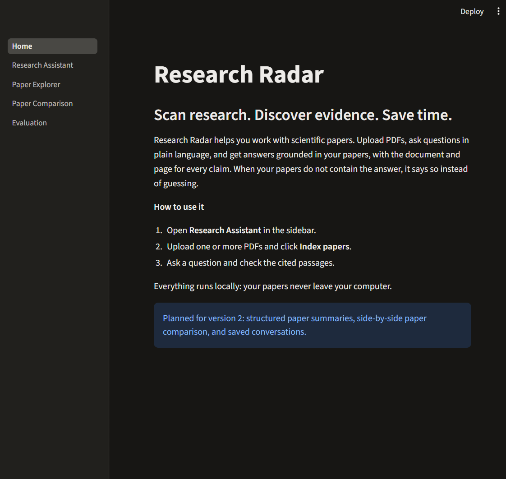
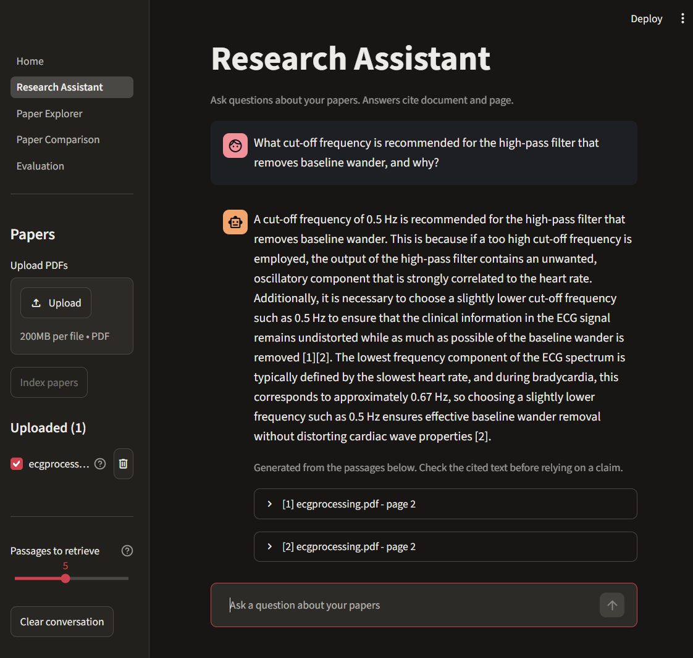
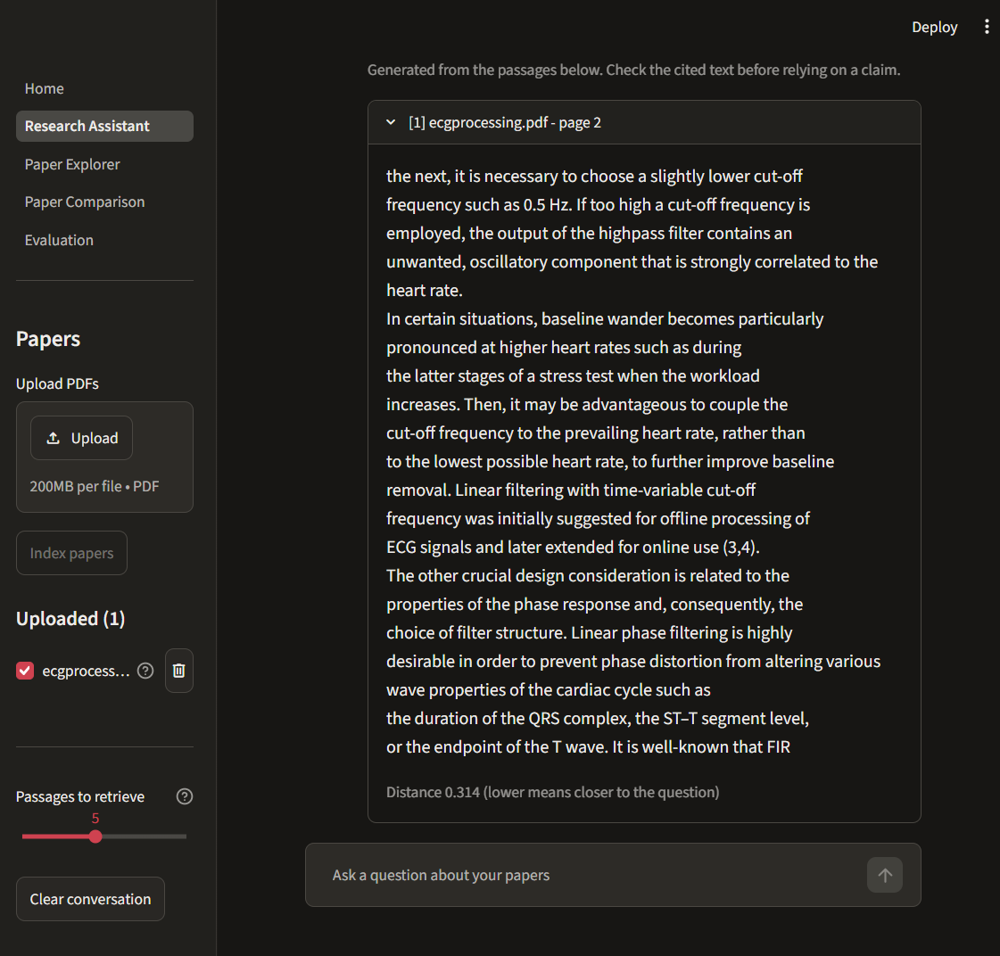
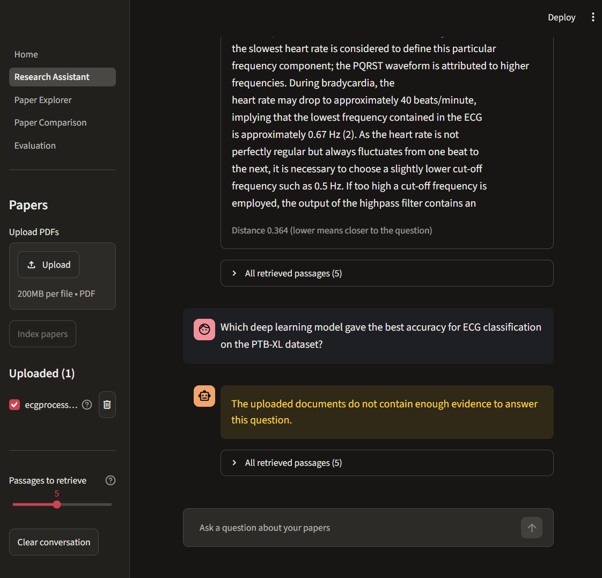
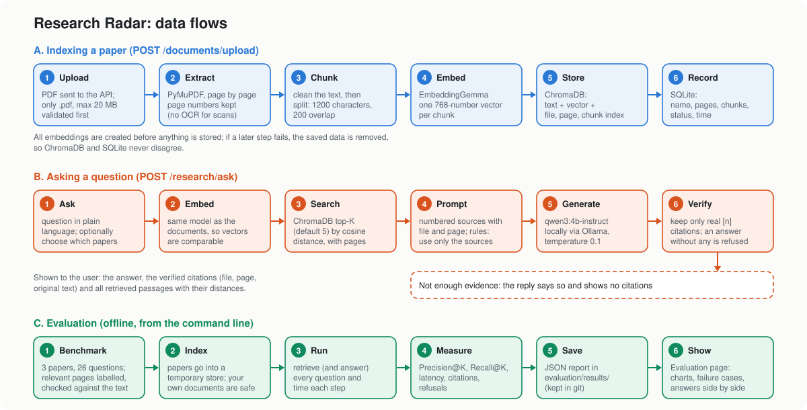
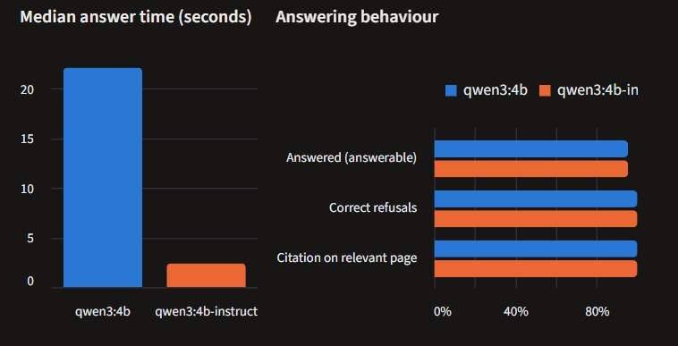

# Research Radar

**Scan research. Discover evidence. Save time.**


[](LICENSE)

Research Radar lets you upload scientific PDFs, ask questions in plain
language, and get answers grounded in your papers, with the document and page
for every claim. When the papers do not contain the answer, it says so instead
of guessing.

Everything runs locally: your documents, the embeddings and the language
model stay on your computer (Ollama, ChromaDB, SQLite). No API keys, no cloud.

## Use case

A student, researcher or analyst with a few PDFs and specific questions (which
dataset, how many patients, what are the limitations) gets answers with the
page as proof, without reading every paper in full. What **Index papers** does,
which questions work well and how to read the citations:
[docs/use_case.md](docs/use_case.md).

## A tour of the app

### Home page



The home page explains the three steps: open **Research Assistant**, upload
PDFs and click **Index papers**, then ask a question and check the cited
passages. The sidebar lists the pages. **Research Assistant** and
**Evaluation** work in version 1; **Paper Explorer** and **Paper Comparison**
are planned for version 2.

### Ask a question and check the evidence



The example paper is a 16-page encyclopedia chapter on ECG signal processing
(Sörnmo and Laguna, *Wiley Encyclopedia of Biomedical Engineering*, 2006),
indexed into 79 passages. The PDF is not part of this repository.

**Sidebar**
- **Upload PDFs** and **Index papers** add a paper to the search.
- **Uploaded** lists your papers. The tick decides whether a question searches
  that paper, the `?` shows its pages and passages, and the bin deletes it.
- **Passages to retrieve** sets how many passages the model sees (5 by default).
- **Clear conversation** empties the chat.

**Chat**
- Your question, then the answer. The numbers `[1]` and `[2]` in the answer
  match the numbered sources underneath it.



Opening a source shows the **original passage** from the paper, with its page
and its **distance** to your question (0.314 here; lower means closer). This
is how you check a claim against the text instead of trusting the answer.

### When the papers do not contain the answer



This chapter is from 2006, so a question about the best deep learning model on
the PTB-XL dataset cannot be answered from it. The app says so (yellow box)
instead of inventing something, and **All retrieved passages** shows what it
searched. This is built in twice: the model is told to answer only from the
retrieved passages, and the code replaces any answer without a valid citation
with this message.

## How it works



1. **Indexing:** a PDF is split into page-aware passages, each passage becomes
   a vector (EmbeddingGemma), and passages, vectors and page numbers are
   stored in ChromaDB.
2. **Asking:** the question is embedded with the same model, the closest
   passages are retrieved, and a local language model (Qwen3) writes an
   answer from those passages only, citing them as `[n]`.
3. **Checking:** citations are verified in code against the retrieved
   passages. Invented references are discarded, and an answer with no valid
   citation is reported as insufficient evidence.
4. **Evaluating:** a labelled benchmark measures retrieval (Precision@K,
   Recall@K, latency) and compares language models.

The component view is in [docs/images/architecture.svg](docs/images/architecture.svg)
and explained in [docs/architecture.md](docs/architecture.md).

## Features

- Upload several PDFs and choose which papers to search.
- Answers with citations: file, page and the original passage.
- Explicit "not enough evidence" replies, with all retrieved passages and
  their distances available for inspection.
- Persistent storage: documents survive restarts; papers can be deleted.
- Evaluation page: retrieval metrics, failure cases, run comparison, and a
  side-by-side comparison of language models with manual faithfulness scoring.
- REST API with automatic documentation, 222 automated tests, Docker Compose.

## Results

Measured on a benchmark of 3 papers (two on SPECT cardiac imaging, one on
EEG-fMRI) and 26 questions with relevant pages labelled (22 answerable, 4 not
answerable). Details and caveats: [docs/experiments.md](docs/experiments.md).

**Retrieval** (EmbeddingGemma, top-K passages):

| K | Precision@K | Recall@K |
|---:|---:|---:|
| 1 | 0.64 | 0.34 |
| 3 | 0.62 | 0.77 |
| 5 | 0.54 | 0.89 |
| 10 | 0.41 | 0.96 |

Median retrieval time: 32 ms.

**Language models** (same retrieved passages for both):

| | qwen3:4b | qwen3:4b-instruct |
|---|---:|---:|
| Answered (answerable) | 21 of 22 | 21 of 22 |
| Correct refusals | 4 of 4 | 4 of 4 |
| Median answer time | 22.2 s | 2.4 s |

The instruct model is the default: about 9 times faster, with the same
automatic scores. The automatic checks cannot tell whether a cited claim is
true: the slower model once gave a wrong answer while citing a correct page,
which is why faithfulness is also scored by hand. The benchmark is small, so
treat the numbers as indicative.



The Evaluation page shows the comparison (left: median seconds per answer;
right: how often each model answers, refuses correctly and cites a relevant
page). The two bars are equal on the right, but `qwen3:4b` takes about 22 s per
answer and `qwen3:4b-instruct` about 2.4 s. The reason is that `qwen3:4b` is a
*thinking* model: it writes a long chain of reasoning before the answer (the
app hides it), so it generates many more words each time. The instruct variant
answers directly. With equal automatic scores, and the one clearly wrong answer
coming from the slower model, the faster instruct model is the default.

## Quick start

Requires Python 3.11 and [Ollama](https://ollama.com). Get the code:

```powershell
git clone https://github.com/teodora-taleska/research_radar.git
cd research_radar
```

Create a Python 3.11 environment and install the dependencies. With conda:

```powershell
conda create -n research_radar python=3.11
conda activate research_radar
pip install -r requirements.txt
```

Without conda, any Python 3.11 virtual environment works:
`python -m venv .venv`, activate it (`.venv\Scripts\activate` on Windows,
`source .venv/bin/activate` on macOS and Linux), then
`pip install -r requirements.txt`.

Download the two models (about 3 GB, once):

```powershell
ollama pull embeddinggemma
ollama pull qwen3:4b-instruct
```

Ollama must be running while you use the app. `ollama list` shows the
downloaded models and fails if Ollama is not running; in that case start the
Ollama app, or run `ollama serve`.

Start the backend and the frontend in two terminals from the project folder:

```powershell
uvicorn app.api.main:app --reload
```

```powershell
streamlit run frontend/Home.py
```

Open http://localhost:8501, choose **Research Assistant**, upload PDFs, click
**Index papers**, and ask a question. New here? [docs/use_case.md](docs/use_case.md)
explains each step and what to ask. API documentation is at
http://127.0.0.1:8000/docs. All settings are environment variables, listed in
[docs/development.md](docs/development.md).

### With Docker

Docker runs the API and the frontend. You need no Python environment, but you
do need these three things before the first start:

1. **Docker Desktop**, running (it needs a few GB of free memory).
2. **Ollama**, installed and running on your computer.
3. **The two models downloaded** once: `ollama pull embeddinggemma` and
   `ollama pull qwen3:4b-instruct`. Docker does not include them.

Then, in the project folder:

```powershell
docker compose up --build
```

Open http://localhost:8501. Uploaded documents are kept in a Docker volume. If a
copy started without Docker is still running, stop it first (or use other
ports). See [docs/development.md](docs/development.md) for ports, settings and
running the evaluation in a container.

## Evaluation

```powershell
python -m evaluation.run_evaluation
python -m evaluation.experiments.llm_comparison
```

The first measures retrieval; the second compares the language models. Results
are saved in `evaluation/results/` and shown on the **Evaluation** page. How to
prepare a benchmark: [evaluation/datasets/README.md](evaluation/datasets/README.md).

## Project structure

```
app/            FastAPI backend
  api/            endpoints and dependency wiring
  ingestion/      PDF extraction, cleaning, chunking
  embeddings/     embedding provider (Ollama)
  vectorstore/    ChromaDB store
  retrieval/      semantic retrieval
  generation/     prompts, LLM provider, citation-checked answers
  services/       document indexing, question answering
  database/       SQLite document records
  schemas/        API request and response models
frontend/       Streamlit app (pages, components, API client)
evaluation/     benchmark, metrics, experiments, results
tests/          unit, integration and frontend tests
docs/           architecture, API, methodology, experiments, demo script
Dockerfile, docker-compose.yml
```

## Tests and code quality

```powershell
python -m pytest tests -q
python -m ruff check .
```

The tests use fake models and run without Ollama.

## Known limitations

- Scanned PDFs are not supported (no OCR).
- Each question is answered independently, and the chat is lost when the
  browser tab is refreshed.
- Whether the model refuses unanswerable questions depends on the model;
  retrieval distance alone does not separate them.
- Citations are verified to exist, not to be faithful to the claim.
- The benchmark is small (3 papers, 26 questions), written by the author, and
  relevance is judged per page, which is lenient.
- Docker packages only the API and the frontend; Ollama and its models must be
  installed separately.
- Local models on a laptop are slow with thinking models and need free memory.

## Roadmap (version 2)

Not implemented yet. The detailed plan, with where each feature would live in
the code, is in [docs/roadmap.md](docs/roadmap.md).

- Paper Explorer (structured summaries) and Paper Comparison pages.
- Saved conversations and follow-up questions.
- PostgreSQL with migrations; hybrid search (BM25) and reranking.
- Better refusal of unanswerable questions.
- Public hosted demo with a hosted model provider; optional containerised Ollama.
- OCR for scanned PDFs; larger benchmark with more metrics (MRR, nDCG);
  chunk-size and embedding-model comparisons; continuous integration.

## Documentation

- [docs/use_case.md](docs/use_case.md): why and how to use it, what to ask
- [docs/architecture.md](docs/architecture.md): components and data flows
- [docs/api.md](docs/api.md): REST endpoints
- [docs/methodology.md](docs/methodology.md): methods and evaluation
- [docs/experiments.md](docs/experiments.md): experiments and results
- [docs/development.md](docs/development.md): setup, configuration, Docker
- [docs/roadmap.md](docs/roadmap.md): version 2 plan (features not built yet)

## License

MIT, see [LICENSE](LICENSE).
