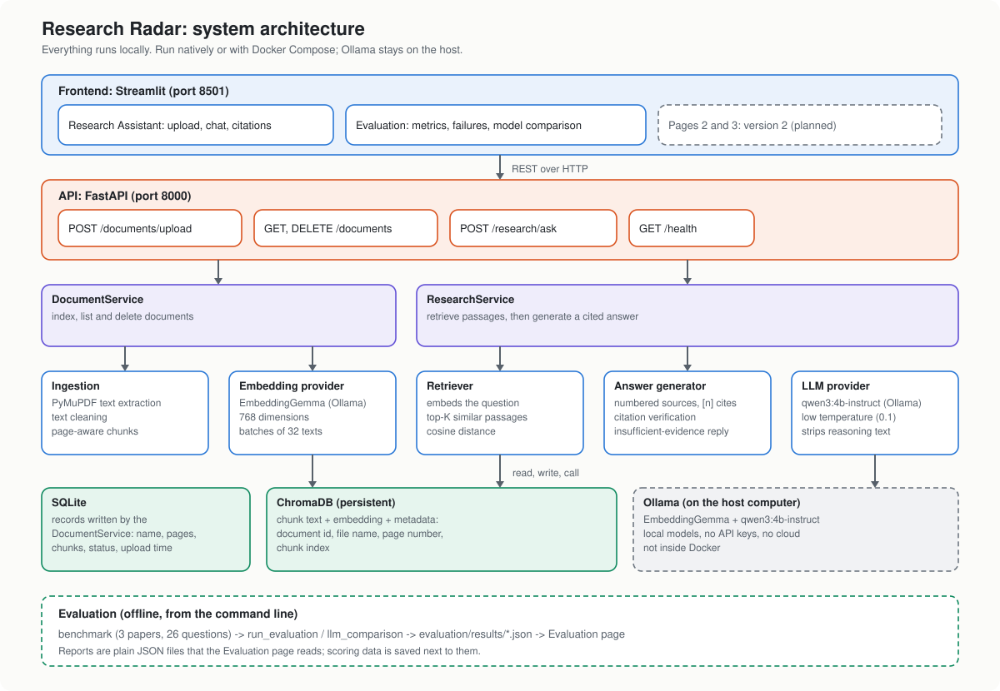
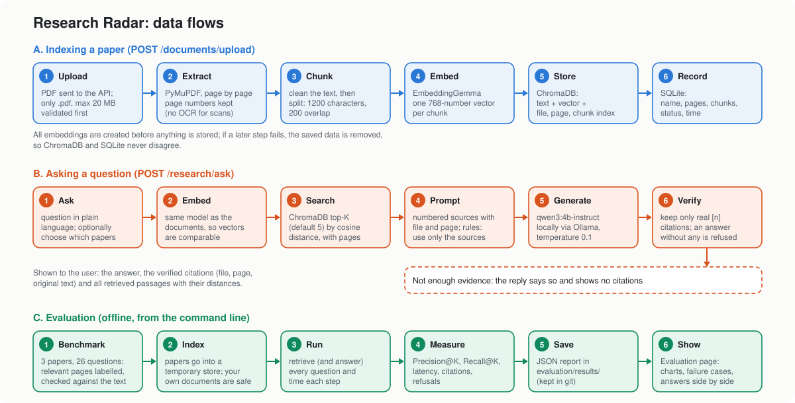

## PDF Ingestion Architecture

The document ingestion pipeline is responsible for transforming uploaded
scientific PDF files into structured text chunks.

### Processing stages

1. PDF extraction:
   PyMuPDF extracts text from each PDF page independently.

2. Text cleaning:
   Extracted text is normalized to remove unnecessary whitespace,
   line-break artifacts, and common hyphenation problems.

3. Text chunking:
   LangChain RecursiveCharacterTextSplitter divides each page into
   overlapping text chunks.

4. Metadata preservation:
   Every chunk retains its page number, global chunk index, and
   character position within its source page.

### Initial chunking configuration

| Parameter | Value |
|---|---:|
| Chunk size | 1200 characters |
| Chunk overlap | 200 characters |
| Splitting strategy | Recursive |
| Page numbering | One-based |
| Chunk numbering | Zero-based |

These values represent an initial baseline and will be evaluated
against alternative configurations in the evaluation phase.

### API integration

The FastAPI endpoint POST /documents/upload accepts a PDF file
and returns document metadata and chunk previews.

### Current limitations

- Scanned PDFs are not processed because OCR is not implemented.
- Uploaded PDFs are processed in memory; the original PDF file is not
  stored, only its chunks, embeddings and metadata.

## System Architecture

Research Radar keeps each responsibility in its own module so components
can be replaced independently (for example Ollama by a hosted provider).

| Layer | Module | Responsibility |
|---|---|---|
| Frontend | `frontend/` (Streamlit) | Upload, paper selection, chat, citations |
| API | `app/api/` (FastAPI) | HTTP endpoints, error mapping, dependency wiring |
| Services | `app/services/` | Indexing (`DocumentService`) and question answering (`ResearchService`) |
| Ingestion | `app/ingestion/` | PDF extraction, cleaning, chunking |
| Embeddings | `app/embeddings/` | `EmbeddingProvider` interface, Ollama implementation |
| Vector store | `app/vectorstore/` | Persistent ChromaDB collection, cosine search |
| Retrieval | `app/retrieval/` | Embeds a question and searches the store |
| Generation | `app/generation/` | `LLMProvider` interface, prompts, citation-verified answers |
| Metadata | `app/database/` | SQLAlchemy and SQLite document records |
| Evaluation | `evaluation/` | Benchmark, Precision@K, Recall@K, latency |

### Indexing flow (POST /documents/upload)

1. The PDF is extracted, cleaned and split into page-aware chunks.
2. Chunks are embedded in batches of 32 with EmbeddingGemma (768 dimensions).
3. Chunks, embeddings and metadata (document id, filename, page number,
   chunk index) are written to ChromaDB.
4. A document record (filename, pages, chunks, status, time) is written to
   SQLite.

All embeddings are generated before anything is written. If storing the
vectors or the record fails, the document is removed again, so ChromaDB and
SQLite never disagree.

### Question flow (POST /research/ask)

1. The question is embedded with the same model used for the documents.
2. ChromaDB returns the top-K most similar chunks with cosine distances,
   optionally restricted to selected documents.
3. The chunks are numbered and sent to the LLM (Qwen3 via Ollama) with
   instructions to use only those sources and to cite them as `[n]`.
4. `AnswerGenerator` verifies every citation against the supplied chunks.
   Invented numbers are discarded, and an answer with no valid citation, an
   empty retrieval, or a model refusal is reported as insufficient evidence.
5. The response contains the answer, verified citations (document, page,
   original text) and all retrieved passages with their distances.

### Storage

| Data | Store | Default location |
|---|---|---|
| Chunks, embeddings, page metadata | ChromaDB (persistent) | `data/chroma` (`CHROMA_PERSIST_DIR`) |
| Document records | SQLite via SQLAlchemy | `data/research_radar.db` (`DATABASE_URL`) |

SQLite is used because the MVP is single-user and the records are small.
Because access goes through SQLAlchemy, moving to PostgreSQL only requires
a different `DATABASE_URL` (migrations with Alembic are future work).
